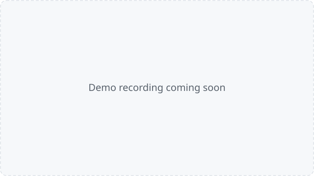
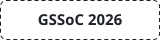
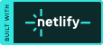
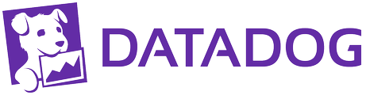

<div align="center">


# Reframe

**Resize, trim and convert videos in your browser. Your video never leaves your device.**

[](https://github.com/reframe-oss/reframe/stargazers)
[](https://github.com/reframe-oss/reframe/issues)
[](LICENSE)
[](https://nextjs.org)
[](https://github.com/reframe-oss/reframe/actions/workflows/main.yml?query=branch%3Amain)
[](https://app.netlify.com/sites/reframe-os/deploys)
[](https://snyk.io/test/github/reframe-oss/reframe)

### [Open Reframe → reframe-os.netlify.app](https://reframe-os.netlify.app)

<!-- TODO: replace with a short screen recording of an export (docs/assets/demo.gif, under 5 MB). -->


</div>

## Features

- Resize for Reels, TikTok, Shorts, Instagram, YouTube and more, or any custom size; fit or fill
- Trim, rotate, change speed (0.25× to 4×), mute or adjust audio, add background music
- Text and image overlays; brightness, contrast, saturation and sharpness
- Export to MP4, WebM, MKV or GIF with a quality slider
- Undo and redo, recovery after a refresh, and project files you can reopen
- Export profiles: built-in and saved output settings in one click, with safe-area guides ([docs/EXPORT_PROFILES.md](docs/EXPORT_PROFILES.md))
- Keyboard shortcuts for everything common: see [docs/USAGE.md](docs/USAGE.md)

## How it works

Reframe runs [FFmpeg](https://ffmpeg.org) compiled to WebAssembly
([FFmpeg.wasm](https://ffmpegwasm.netlify.app)) in a Web Worker, so your video
is processed on your own device and the page stays responsive. When the site is
cross-origin isolated (the `Cross-Origin-Opener-Policy` and
`Cross-Origin-Embedder-Policy` headers), browsers allow `SharedArrayBuffer` and
Reframe uses the faster multi-threaded FFmpeg; otherwise it falls back to the
single-threaded build. The details are in [docs/ARCHITECTURE.md](docs/ARCHITECTURE.md).

## Quick start

You need [Bun](https://bun.sh) 1.x and Node.js 20.9 or newer.

```bash
git clone https://github.com/reframe-oss/reframe.git && cd reframe
bun install
bun run dev
```

Then open http://localhost:3000. Deploying your own copy: [docs/DEPLOYMENT.md](docs/DEPLOYMENT.md). Something not working? See [docs/TROUBLESHOOTING.md](docs/TROUBLESHOOTING.md).

## Privacy

Your videos never leave your device. Reframe collects anonymous performance and
error data to improve export reliability; you can opt out in Settings.
Exactly what is sent, and what never is, is listed on the
[privacy page](https://reframe-os.netlify.app/privacy) and in
[docs/DATADOG.md](docs/DATADOG.md).

## Contributing

Contributions of every size are welcome. Read [CONTRIBUTING.md](CONTRIBUTING.md)
to set up, claim an issue with `/assign`, and open a pull request.

## Part of GirlScript Summer of Code 2026

<a href="https://gssoc.girlscript.tech">
  <picture>
    <source media="(prefers-color-scheme: dark)" srcset="docs/assets/brand/gssoc-dark.svg">
    
  </picture>
</a>

Reframe was an official GSSoC'26 project. Pick one of the
[`gssoc'26` issues](https://github.com/reframe-oss/reframe/issues?q=is%3Aopen+label%3A%22gssoc%2726%22)
and claim it by commenting `/assign` ([how claiming works](CONTRIBUTING.md#claim-an-issue)).
Maintainers add the labels.

## Supported by

<p>
  <a href="https://www.netlify.com">
    <picture>
      <source media="(prefers-color-scheme: dark)" srcset="docs/assets/brand/netlify-dark.svg">
      
    </picture>
  </a>
  &nbsp;&nbsp;
  <a href="https://snyk.io">
    <picture>
      <source media="(prefers-color-scheme: dark)" srcset="docs/assets/brand/snyk-dark.svg">
      
    </picture>
  </a>
  &nbsp;&nbsp;
  <a href="https://www.datadoghq.com">
    <picture>
      <source media="(prefers-color-scheme: dark)" srcset="docs/assets/brand/datadog-dark.png">
      
    </picture>
  </a>
  &nbsp;&nbsp;
  <a href="https://www.chromatic.com">
    <picture>
      <source media="(prefers-color-scheme: dark)" srcset="docs/assets/brand/chromatic-dark.svg">
      
    </picture>
  </a>
</p>

[Netlify](https://www.netlify.com) hosts the site and its deploy previews.
[Snyk](https://snyk.io) scans dependencies for vulnerabilities.
[Datadog](https://www.datadoghq.com) Real User Monitoring tracks export
reliability, through the Datadog Open Source Program.
[Chromatic](https://www.chromatic.com) runs visual review of UI changes.

## Contributors

<a href="https://github.com/reframe-oss/reframe/graphs/contributors">
  
</a>

Reviewers, mentors, designers and others who don't commit code are credited
with [all-contributors](.github/ALL_CONTRIBUTORS.md).

## License

[MIT](LICENSE)
