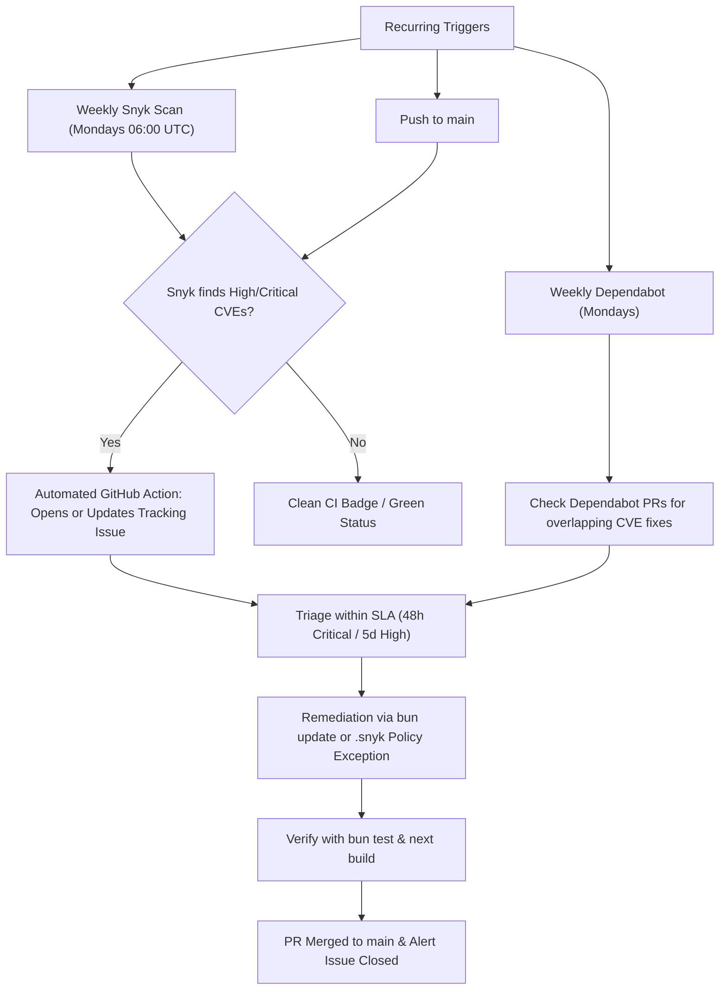

# Dependency Review & Vulnerability Triage Cadence

This document establishes the recurring dependency update and vulnerability review process for Reframe, resolving [#1790](https://github.com/reframe-oss/reframe/issues/1790).

---

## 1. Overview & Purpose

Reframe processes video client-side using FFmpeg.wasm, meaning code security and dependency supply chain integrity are essential. 

Automated security scans in CI can easily become background noise if there is no defined response process when scans report vulnerabilities. This cadence establishes a proactive, human-in-the-loop review rhythm combining:
- **Continuous & Recurring Snyk Scanning:** Detecting high and critical CVEs across direct and transitive dependencies.
- **Weekly Dependabot Automated Updates:** Keeping npm packages and GitHub Actions up to date.
- **Automated Issue Alerting:** Automatically raising or updating a tracking issue when Snyk detects high/critical vulnerabilities on `main`.
- **Defined Triage SLAs:** Clear response timelines and resolution procedures so vulnerabilities are triaged rather than ignored.

---

## 2. Review Cadence & Architecture



### Automation Components

| Tool | Frequency | Target | Action on Finding |
|---|---|---|---|
| **Snyk Scan** (`.github/workflows/snyk.yml`) | Every Monday at 06:00 UTC & on push to `main` | Production & transitive dependencies (`package-lock.json` generated from `package.json`) | Fails CI and automatically opens or updates a GitHub issue labeled `security` & `dependencies`. |
| **Dependabot** (`.github/dependabot.yml`) | Every Monday | `npm` packages & `github-actions` | Opens up to 5 automated update PRs. |
| **Manual Scan** (`npm run security`) | On demand | Local developer workspace | Outputs detailed vulnerability breakdown and path traces. |

---

## 3. Triage SLAs & Response Timelines

When a dependency vulnerability is detected, the following response windows apply:

| Severity | CVSS Score | Initial Triage Window | Remediation / Mitigation Window |
|---|---|---|---|
| **Critical** | 9.0 – 10.0 | Within **48 hours** | Within **7 calendar days** |
| **High** | 7.0 – 8.9 | Within **5 business days** | Within **14 calendar days** |
| **Moderate / Low** | 0.1 – 6.9 | Reviewed weekly during regular Dependabot cycles | Next planned dependency release |

- **Initial Triage:** A maintainer or assigned contributor reviews the alert, confirms whether the vulnerability is reachable/exploitable, and identifies whether a patch is available.
- **Remediation:** Merging an updated version or applying a documented `.snyk` exception.

---

## 4. Step-by-Step Triage & Remediation Workflow

### Step 1: Inspect the Alert

When Snyk detects vulnerabilities on `main`:
1. An issue titled `🔒 [Security Alert] High/Critical vulnerabilities detected by Snyk` is created or commented on automatically.
2. Open the linked workflow run log to inspect:
   - Affected package name and installed version
   - Vulnerability CVE / Snyk identifier
   - Vulnerability path (e.g., `reframe > next > @next/env > postcss`)
   - Whether a fixed version is available

### Step 2: Cross-Reference Dependabot PRs for Overlap

Before manually updating dependencies, check open [Dependabot PRs](https://github.com/reframe-oss/reframe/pulls?q=is%3Apr+is%3Aopen+label%3Adependencies):
- Dependabot often opens an automated bump PR for the exact vulnerable package on Monday mornings.
- If a Dependabot PR addresses the flagged package:
  1. Review the PR's CI checks and changelog.
  2. Test locally: `bun test` and `bun run build`.
  3. Merge the Dependabot PR. Snyk will re-scan `main` automatically upon merge.

### Step 3: Local Reproduction

To run the exact Snyk scan locally:

```bash
# Ensure SNYK_TOKEN is in your environment if scanning authenticated:
export SNYK_TOKEN="your-token" # or set in PowerShell: $env:SNYK_TOKEN="your-token"

# Run the project security script:
npm run security
```

> [!IMPORTANT]
> **Lockfile Rule:** Reframe uses `bun.lock` as the single source of truth. The `npm run security` script temporarily creates `package-lock.json` because Snyk's parser requires npm/yarn format. **Never commit `package-lock.json`** to git.

### Step 4: Patching with Bun

If updating manually:

```bash
# 1. Update the target package using bun
bun update <package-name>

# 2. Run all tests to ensure no regressions
bun test

# 3. Verify production build
bun run build

# 4. Run linter
bun run lint

# 5. Verify the vulnerability is cleared
npm run security
```

Submit a PR with conventional commit format:
```
fix(security): bump <package-name> to resolve <CVE-ID> (#1790)
```

---

## 5. False Positives & Dev-Only Exceptions (`.snyk`)

If a vulnerability has no upstream fix available or is provably non-exploitable (for example, a dev-dependency tool with no client-side runtime path in our static export):

1. **Criteria for an exception:**
   - The affected code path is **not reachable** in the client-side browser bundle.
   - No upstream patch exists yet, or an immediate upgrade would introduce catastrophic breaking changes.
2. **Documenting the exception in `.snyk`:**
   Add the finding to the `ignore` section in `.snyk`. Every exception **must** include a clear rationale and an expiration date (maximum 90 days):

```yaml
version: v1.25.0
ignore:
  SNYK-JS-EXAMPLE-123456:
    - '*':
        reason: 'Unreachable: dev-only build dependency with no client-side runtime execution in static export.'
        expires: 2026-12-31T00:00:00.000Z
patch: {}
```

> [!WARNING]
> Never add an ignore rule without an expiration date. Expired ignores ensure that newly released upstream fixes are promptly revisited rather than forgotten.

---

## 6. Roles & Responsibilities

- **Maintainers:**
  - Monitor automated Snyk alert issues and assign triage owners within the SLA window.
  - Review and merge weekly Dependabot PRs.
  - Review any proposed `.snyk` ignore exceptions.
- **Contributors & GSSoC'26 Participants:**
  - Can request assignment on open Snyk vulnerability alert issues to research fixes or upgrade dependencies.
  - Follow the testing and lockfile standards in `CLAUDE.md`.
